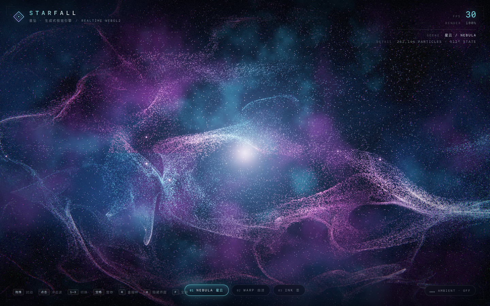
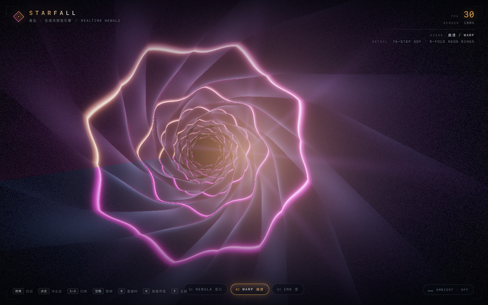
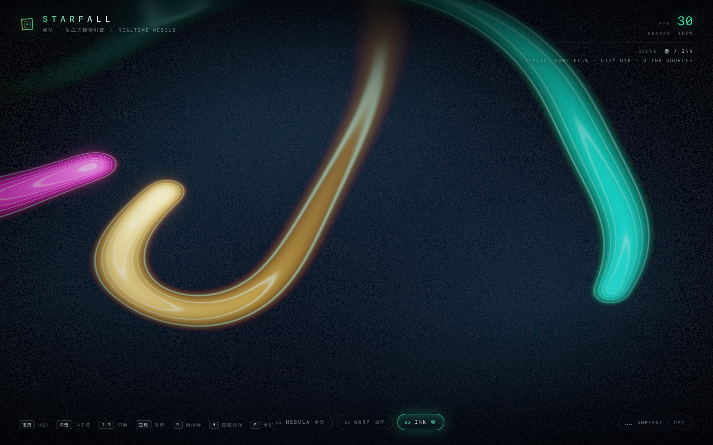
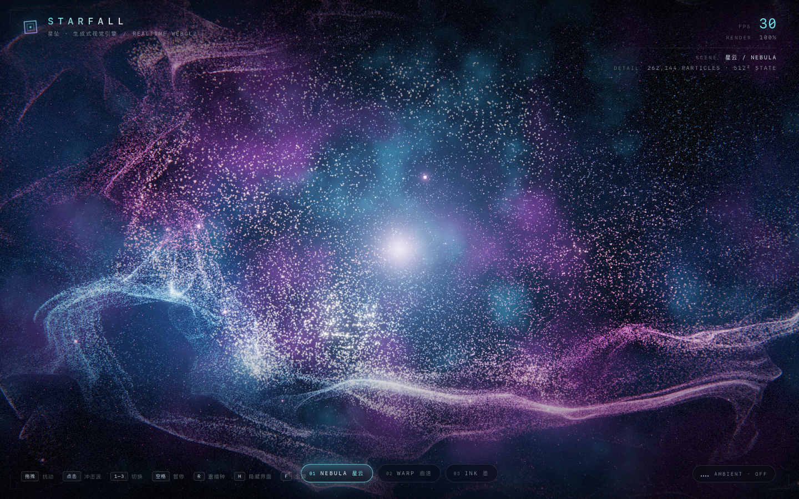
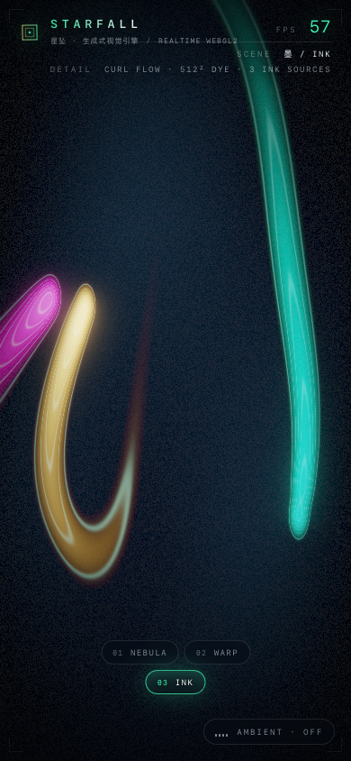

# STARFALL · 星坠

> 零依赖、零构建的实时生成式视觉引擎。WebGL2 · HDR 泛光 · 262,144 粒子 · 光线步进霓虹隧道 · 半拉格朗日墨流 · 程序化环境音。



## 立即体验

三种打开方式，任选其一：

```bash
# 1) 本机开发服务器（推荐）
node serve.mjs            # → http://127.0.0.1:5199/

# 2) 直接双击 index.html（经典脚本，file:// 可用，无需服务器）

# 3) 单文件离线发行版（90 KB，全部内联，发给别人双击即开）
open dist/starfall.html
```

环境要求：支持 WebGL2 + `EXT_color_buffer_float` 的现代浏览器（Chrome / Edge / Safari 16+ / Firefox）。没有构建依赖，也没有 npm 依赖。

## 操作

| 输入 | 效果 |
| --- | --- |
| 鼠标拖拽 | 扰动流场 / 搅拌粒子 / 旋转隧道 |
| 单击（或触摸） | 冲击波：粒子爆散、隧道闪光、墨环扩散 |
| 滚轮 | 蓄能：隧道加速、亮度脉冲 |
| `1` `2` `3` | 切换场景（也可以点底部药丸） |
| `空格` | 暂停 / 继续 |
| `R` | 重新播种（粒子重置、隧道重排、墨色清空） |
| `H` | 隐藏 / 显示 HUD（纯净画面） |
| `F` | 全屏 |
| `M` / 右下角按钮 | 开启程序化环境音（需一次点击手势） |

## 三个场景

| 场景 | 截图 | 技术 |
| --- | --- | --- |
| **NEBULA 星云** |  | 512² RGBA32F 状态纹理 GPGPU，262,144 粒子；卷曲噪声 + 差速轨道 + 指针涡旋；加色混合 HDR 点精灵 |
| **WARP 曲速** |  | 光线步进 SDF 隧道，76 步；8 折万花筒折叠 + 霓虹环；中心差分法线 + 体积辉光 |
| **INK 墨** |  | 512² 半拉格朗日染料对流；解析流场 + 3 个移动墨源；指针提笔、点击墨环 |

交互瞬间（星云冲击波）：



移动端（390×844）：



## 音频

纯 WebAudio 合成，无任何采样文件：Am–F–C–G 慢速和声垫、次低频 drone、呼吸噪声、五声音阶钟琴与极轻脉冲，经过程序生成的卷积混响与延迟。`AnalyserNode` 实时提取低/中/高频能量，驱动三套场景的亮度、泛光、色差与粒子速度。**不开启音频时所有动画也完整成立。**

## 技术要点

- **HDR 管线**：场景渲染到 `RGBA16F`，5 级 bloom（亮部软阈值 → 13-tap 降采样链 → 9-tap 叠加升采样）→ ACES 色调映射 → 边缘色差、暗角、胶片颗粒、抖动。
- **GPGPU 粒子**：位置/速度存在一张 512×512 浮点纹理里，片元着色器积分；粒子渲染用 `gl_VertexID` + `texelFetch`，零顶点属性。
- **场景接口**：`init / resize / update / render` 四段式，所有场景只写当前绑定的 HDR FBO；主循环统一驱动动画与切场淡入淡出。
- **自适应画质**：EMA 帧率低于 47 fps 时自动降低内部渲染分辨率（HUD 的 `RENDER` 会显示比例），避免低电量或集成显卡下卡顿。
- **零资产 HUD**：纯 CSS + DOM + 内联 SVG，无外部字体/图片；场景主题色通过 CSS 变量无缝切换。
- **容错**：单个场景初始化失败会被捕获并提示，其余场景继续可用；`webglcontextlost` 自动提示并在恢复时重载。

## 性能（实测）

Apple M2，1440×900，headless Chrome + ANGLE/Metal，`gl.finish()` 同步测得的单帧 GPU 时间：

| 场景 | 帧时间 | 等效帧率 |
| --- | --- | --- |
| NEBULA | 8.36 ms | ~120 fps |
| WARP | 8.21 ms | ~122 fps |
| INK | 1.82 ms | ~550 fps |

正常 60 Hz 显示下三场景均可满帧运行；低电量模式触发降频时由自适应画质兜底。

## 自测工具

```bash
# 截图 + 控制台错误 + 画面亮度统计（无依赖，自动拉起 headless Chrome）
node verify/shot.mjs \
  --url='http://127.0.0.1:5199/?adaptive=0' \
  --scene=tunnel --wait=3500 \
  --out=shots/check.png --w=1440 --h=900

# 真实帧时间（禁用 vsync，配合 gl.finish 同步）
node verify/shot.mjs --url='http://127.0.0.1:5199/?adaptive=0&scale=1' \
  --probe --novsync --eval='window.__NEB_BENCH__=true' \
  --scene=nebula --out=/tmp/perf.png
```

页面调试接口（控制台 / CDP 可用）：

```js
__NEB_DEBUG.ready            // 首帧是否完成
__NEB_DEBUG.fps              // EMA 帧率
__NEB_DEBUG.sample()         // Promise<{avg,max,center,nonBlack,avgRGB}>
__NEB_DEBUG.switchScene('fluid')
__NEB_DEBUG.setScale(0.75)   // 手动降渲染分辨率
__NEB_DEBUG.toggleAudio()
```

URL 参数：`?adaptive=0` 关闭自适应、`?scale=0.75` 固定分辨率、`?hud=0` 隐藏 HUD、`?paused=1` 暂停启动。

## 目录结构

```
index.html            # 页面骨架 + HUD
src/
  style.css           # HUD 视觉
  glutil.js           # WebGL2 工具（编译/纹理/FBO/乒乓/全屏三角形）
  post.js             # HDR bloom + 色调映射合成
  main.js             # 主循环、场景调度、输入、HUD、自适应画质
  audio.js            # 程序化环境音 + 频谱分析
  scenes/
    nebula.js         # GPGPU 粒子星云
    tunnel.js         # 光线步进隧道
    fluid.js          # 半拉格朗日墨流
verify/shot.mjs       # 无依赖截图/诊断 CLI
build.mjs             # 内联打包 → dist/starfall.html
serve.mjs             # 零依赖静态服务器
CONTRACT.md           # 场景/音频接口契约（扩展新场景看这里）
```

## 扩展新场景

在 `src/scenes/` 新建一个经典脚本，按 `CONTRACT.md` 注册 `window.NEB.scenes.<id>`，并在 `index.html` 里加一行 `<script>` 即可（单文件版重新 `node build.mjs`）。

---

Made with 🩵 by DeepSeek Harness.
